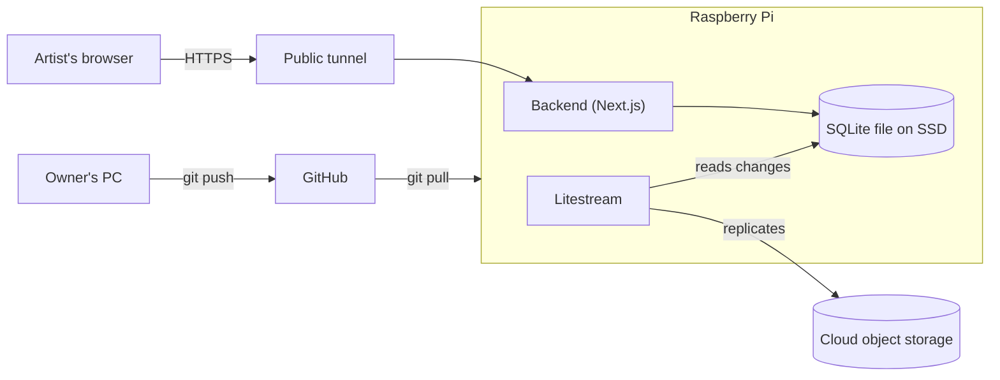

# ConArt architecture overview

| | |
|---|---|
| **Owner** | Project owner |
| **Last reviewed** | 2026-10-11 |
| **Review cadence** | On every change that moves a boundary |
| **Status** | Backend, data and frontend confirmed on 2026-10-11. |

This document describes what ConArt is and how it is shaped. It is written for a developer who did not build it, or for the owner returning after months away.

---

## Part 1: Backend and data

### 1. Purpose and scope

ConArt lets an artist record each sale made at a convention and see what sold. It is a free personal project. The backend stores accounts, items, events and sales, and serves them to the browser app.

Inside the boundary: the backend API, the SQLite database, replication to cloud storage, and the Raspberry Pi that hosts them.

Outside the boundary: the browser UI (Part 2), GitHub (source and CI), the home internet connection, and the public tunnel provider, which is treated as a dependency.

### 2. Quality attributes

Ranked. When two conflict, the higher one wins.

| Rank | Attribute | Target | Why it matters | Measured by |
|---|---|---|---|---|
| 1 | Durability | No recorded sale is lost. Replica lag under 1 minute. | A sale is money and the artist's only record | Replication status; quarterly restore test |
| 2 | Availability at events | Reachable 99% of convention hours. Recovers within 5 minutes of a reboot, with no manual steps. | Downtime at a stand loses sales | Free uptime monitor on `/api/health`, 5-minute check |
| 3 | Simplicity | One app, one database file, two background services. | One maintainer with limited time | Services listed in section 8 |
| 4 | Cost | 0 EUR recurring. A domain is optional. | Free personal project | Monthly bill |
| 5 | Responsiveness | A sale is saved in under 1 second on the home connection. | Queues form at busy stands | Manual check before each release |

Trade-off: when durability and availability conflict, durability wins. The API rejects a sale it cannot store, instead of accepting it and losing it.

### 3. Constraints

- **Hosting:** a Raspberry Pi on the owner's home network. Pi 5 with at least 4 GB RAM, running 64-bit Raspberry Pi OS.
- **Cost:** no paid services.
- **Network:** dynamic home IP and no control over the router, so no port forwarding.
- **Storage:** SD cards wear out under frequent writes, so the database lives on a USB SSD.
- **Build location:** the SQLite driver is a native module and must be built for the Pi's ARM64 CPU, so builds run on the Pi, not on the Windows PC.
- **Team:** one maintainer, no code review.

### 4. Context

| Neighbour | Direction | What flows | Protocol | Owner |
|---|---|---|---|---|
| Artist's browser | In and out | Sign-in, item lists, sale records | HTTPS, JSON | Artist |
| Public tunnel | In and out | Encrypted traffic relayed to the Pi | HTTPS | Tunnel provider |
| Cloud object storage | Out | Database replica | S3 API | Storage provider |
| GitHub | In | Source code for deploys | git | Owner |

### 5. Containers

| Container | Responsibility | Technology | Called by | Calls |
|---|---|---|---|---|
| Backend | Authenticates artists and stores items, events and sales | Next.js route handlers, TypeScript, Node.js LTS | Browser, through the tunnel | Database |
| Database | Stores all records | SQLite in WAL mode, file on USB SSD | Backend | Nothing |
| Replicator | Streams database changes to cloud storage | Litestream, systemd service | Database file | Cloud storage |
| Tunnel | Gives the Pi a public HTTPS address without opening router ports | Tailscale Funnel | Browser | Backend |

The frontend ships in the same Next.js app as the backend, so they share one process. The split in this document is logical.

### 6. Runtime behaviour

#### Record a sale

1. The artist taps an item in the browser. The browser sends the item id, the quantity, and a new `client_sale_id` (UUID) with its session cookie.
2. The backend validates the session. No valid session returns `401`.
3. In one transaction, the backend checks that the item belongs to the artist and is active, copies its current price into the sale, decrements stock if tracked, and inserts the sale. If `client_sale_id` already exists, it returns the existing sale without inserting.
4. The backend returns the stored sale and the browser confirms it.

**When it fails.** A failed write returns `500` and stores nothing. The browser shows an error and reuses the same `client_sale_id`, so a retry cannot create a duplicate. Reads can be retried freely.

#### Sign in

1. The browser posts email and password over HTTPS.
2. The backend checks the password against an argon2id hash. On success it creates a session row and sets an HTTP-only, Secure, SameSite=Lax cookie.
3. Sessions expire after 30 days.

**When it fails.** A wrong email or password returns `401` with the same message for both, so attackers cannot tell which one was wrong. More than 5 attempts per minute from one address returns `429`.

#### Replicate and restore

1. Litestream copies each database change to cloud storage within seconds.
2. Each quarter the owner restores the latest replica to a temporary file, compares row counts with the live database, and records the date in section 11.

**When it fails.** A replication failure does not stop the app, so it is easy to miss. Check the Litestream service status after each deploy.

#### Deploy

1. On the Pi: `git pull`, `pnpm install`, `pnpm build`, then restart the `conart` service.
2. Database migrations run before the app starts.

**When it fails.** If the build fails, the service is not restarted and the old process keeps serving. If a migration fails, the app does not start. If the database is damaged, restore it from the replica.

### 7. Data

| Entity | Key fields | Notes |
|---|---|---|
| Artist | id, email (unique), password_hash, created_at | Email and hash are personal data |
| Session | id (hashed token), artist_id, expires_at | Expires after 30 days |
| Item | id, artist_id, name, price_cents, stock (nullable), active | Stock is null when not tracked. Inactive items are kept for history |
| Event | id, artist_id, name, starts_on, ends_on | Groups sales by convention |
| Sale | id, client_sale_id (unique), artist_id, item_id, event_id (nullable), quantity, unit_price_cents, created_at, voided_at (nullable), void_reason | Append-only |

Rules:
- Money is stored as integer cents, never as floats.
- Sales are never deleted. A mistake is corrected by setting `voided_at` and `void_reason`. Totals exclude voided sales.
- `unit_price_cents` is copied at sale time, so later price changes do not alter past sales.
- Removing an item sets `active` to false. Its sales keep their reference.

System of record:

| Entity | System of record | Copies live in | How copies update | Retention |
|---|---|---|---|---|
| Artist, session | SQLite file on the Pi | Replica in cloud storage | Continuous, within seconds | Account kept until deleted by the owner. Sessions expire after 30 days |
| Item, event | SQLite file on the Pi | Replica in cloud storage | Continuous, within seconds | Kept, including inactive items |
| Sale | SQLite file on the Pi | Replica in cloud storage | Continuous, within seconds | Kept indefinitely, including voided sales |

Personal data: the email and password hash. Store only the argon2id hash, never the password. The cloud replica also holds personal data, so use a private bucket and an access key limited to that bucket.

### 8. Deployment

| Piece | Where | Runs as | Starts on boot |
|---|---|---|---|
| Backend (Next.js) | Raspberry Pi, port 3000 | systemd service `conart` | Yes |
| Database | USB SSD | SQLite file | Not applicable |
| Replicator | Raspberry Pi | systemd service `litestream` | Yes |
| Tunnel | Raspberry Pi | Tailscale service | Yes |
| Replica | Cloud object storage | Written by Litestream | Not applicable |

Environments:
- **Production:** the Pi only.
- **Development:** the Windows PC, with a local SQLite file. It never points at the production file.

Hardening:
- SSH with keys only. Password login disabled.
- Firewall blocks all inbound ports except SSH over Tailscale.
- System updates applied with `apt` monthly.

Single points of failure:
- The Pi and its power supply.
- The home internet. Without it, no sales can be recorded (see section 11).
- The USB SSD. Mitigated by the replica.
- The owner's access to the Pi. Keep a second signed-in Tailscale device.

### 9. Cross-cutting concerns

- **Authentication and authorisation.** Email and password with argon2id, server-side sessions in SQLite, HTTP-only cookies. Every query filters by the artist id from the session. Never trust an artist id sent by the browser.
- **Error handling and retries.** JSON errors with HTTP status codes. Only sale writes are retried, always with the same `client_sale_id`.
- **Observability.** Logs go to the systemd journal (`journalctl -u conart`). `GET /api/health` returns `200` only when the database can be read. An external uptime monitor checks it.
- **Configuration and secrets.** Stored in a `.env` file on the Pi, which git ignores. Includes the session secret and the cloud access key. To rotate, edit `.env` and restart the service.
- **Versioning.** The API serves only ConArt's own browser app, so it changes together with the app. No public API is promised.

### 10. Architecture decisions

Confirmed by the owner on 2026-10-11. No ADR files exist yet; this table is the record of decisions.

| # | Decision | Choice | Why |
|---|---|---|---|
| D1 | Backend | Next.js route handlers in the same app as the frontend | One project and one deploy; no second server to run |
| D2 | Database | SQLite, one file | No database server, little RAM, free, one file to back up |
| D3 | Data access | Drizzle ORM over better-sqlite3 | Thin layer over SQL, light on ARM, typed |
| D4 | Sign-in | Own email and password with server sessions | No third-party account to create or pay for |
| D5 | Public access | Tailscale Funnel | Free, HTTPS included, no router changes, no domain needed |
| D6 | Backups | Litestream to a free S3-compatible bucket | Replica within seconds, free tier |
| D7 | Deploy | Manual `git pull` and build on the Pi, then restart | Simple. A self-hosted CI runner on a public repository can run code from untrusted pull requests |
| D8 | Build location | On the Pi | The native SQLite module must match the Pi's CPU |
| D9 | Interface | Phone-first responsive website, installable as a PWA | Used at stands on phones. Home-screen icon. Offline support can be added later without a rewrite |
| D10 | Data loading | TanStack Query | Retries and caching for weak Wi-Fi. Listed in the README |
| D11 | Components | Tailwind CSS with shadcn/ui | Free, accessible components, faster than building from scratch |
| D12 | Language | English only for now | Simplest. Text can move to translation files later |

### 11. Known problems and direction

| Problem | Impact today | Intended direction | Owner |
|---|---|---|---|
| One Pi on home power and internet | An outage stops all sales | Accept for now. Keep a paper tally as backup | Owner |
| Sales need a live connection | No sales if the stand's Wi-Fi drops | Offline mode later: a browser queue that syncs using `client_sale_id` | Owner |
| Restore never tested | Backups may be unusable | Run a first restore test before the next event; record the date here. Last test: not yet done | Owner |
| Artist isolation not tested | A query could show another artist's sales | Add tests for artist isolation before inviting anyone else | Owner |
| Deletion policy undefined | Unclear obligations if others sign up | Define the policy before public sign-up | Owner |

### 12. Glossary

- **Argon2id:** a password-hashing algorithm designed to resist brute-force attacks.
- **Litestream:** an open-source tool that streams SQLite changes to cloud storage.
- **PWA (progressive web app):** a website that can be installed on a phone and opened like an app.
- **RPO (recovery point objective):** the most recent data you could lose in a failure.
- **Route handler:** a Next.js function that answers an HTTP request.
- **Service worker:** a script the browser runs in the background, able to cache app files.
- **shadcn/ui:** free, copy-in UI components built on Tailwind CSS.
- **SQLite:** a database stored in a single file, with no server process.
- **TanStack Query:** a library that loads, caches and retries server data in the browser.
- **Tunnel:** a service that gives a private machine a public HTTPS address.
- **WAL (write-ahead log):** a SQLite mode that lets Litestream read changes safely while the app writes.

---

## Part 2: Frontend

### 13. Purpose and scope

The browser app artists use at a stand. It lets them sign in, manage items and events, record sales, and review the sales log.

Inside the boundary: pages, UI components, client-side data loading and saving, and the installable app settings (PWA).

Outside the boundary: the API and data rules (Part 1), the tunnel, and the artist's own phone or laptop.

### 14. Quality attributes

Ranked. When two conflict, the higher one wins.

| Rank | Attribute | Target | Why it matters | Measured by |
|---|---|---|---|---|
| 1 | Sale integrity | A sale shows as recorded only after the server confirms it. A failed sale is never lost or duplicated. | Lost or double sales cost money | Throttled-network test in browser devtools before each event |
| 2 | Speed at the stand | Sell screen ready within 2 seconds on a mid-range phone on 4G. A sale takes 3 taps or fewer. | Queues form at busy stands | Timed run on a phone before each event |
| 3 | Clarity | Each screen has one main action. Error messages say what to do next. | Used in a hurry, sometimes by helpers | Walk-through with a non-technical helper before each event |
| 4 | Accessibility | Every control works with a keyboard and is read by a screen reader. Contrast meets WCAG AA. | Inclusive by default; shadcn/ui helps | Lighthouse accessibility score of 90 or more |
| 5 | Cost | 0 EUR. Free libraries only. | Free personal project | Monthly bill |

Trade-off: a sale shows as recorded only after the server confirms it. On slow Wi-Fi this adds a short wait. Integrity beats speed.

### 15. Constraints

- **Devices:** phones (iOS Safari and Android Chrome) and laptops. Layout works from 360 px wide.
- **Network:** stand Wi-Fi can drop. The app must never silently lose an entry.
- **Hosting:** served by the same Next.js app on the Pi. No separate frontend host.
- **Cost:** free libraries and services only.
- **Language:** English only for now.
- **Team:** one maintainer. Prefer few dependencies and standard tools.

### 16. Screens and flows

| Screen | Purpose | Main action | Needs sign-in |
|---|---|---|---|
| Sign in | Email and password | Sign in | No |
| Sell | Record sales quickly | Tap an item. Quantity defaults to 1 | Yes |
| Items | Manage products | Add or edit name, price and stock | Yes |
| Events | Manage conventions | Add an event and set it as active | Yes |
| Sales log | Review sales and totals | Void a sale with a reason | Yes |

Sell screen rules:
- The active event is shown at the top. The app remembers the last event used on this device.
- Tapping an item sends the sale at once. The item shows as pending until the server confirms it.
- A confirmed sale shows a short message with an Undo button for 10 seconds. Undo calls the void action from Part 1, so the record is kept.

**When it fails.** A pending sale stays on screen with a Retry button. Retry reuses the same `client_sale_id`, so it cannot duplicate the sale.

**When the session expires.** A `401` response sends the artist to sign-in and back to the same page afterwards. Pending sales stay on screen and are retried after sign-in.

### 17. Structure and data access

- **Pages:** one route per screen (sign in, sell, items, events, sales log) in the Next.js app.
- **Data access:** every request goes to `/api` routes on the same origin with the session cookie. The session token is in an HTTP-only cookie, so page scripts cannot read it.
- **Server data:** TanStack Query holds loaded data, retries failed reads and writes, and provides loading and error states.
- **Money:** the API sends integer cents. The UI formats them for display only. No arithmetic on floats.
- **Validation:** the browser checks forms for quick feedback. The backend validates again and is the final check.
- **Components:** shadcn/ui components styled with Tailwind CSS. Custom components only where shadcn/ui has none.
- **Deploy:** built and served with the backend as one app. See section 6, Deploy.

### 18. Cross-cutting concerns

- **Errors.** Every failed request shows a plain message and a Retry button. No silent failures.
- **Double taps.** Item buttons are disabled while a sale is pending. Retries reuse the same `client_sale_id`.
- **Touch and text.** Touch targets are at least 44 px tall. Input text is at least 16 px, so iOS does not zoom in on focus.
- **Installable app (PWA).** A web app manifest gives the name, icon and theme colour. The service worker caches only the app's own files (HTML, CSS, JavaScript, icons). It never caches API responses or sales data.
- **Updates.** A new deploy is picked up on the next visit. If an old version still shows, reload once.
- **Secrets.** Only values safe for every visitor may use the `NEXT_PUBLIC_` prefix, because page code is public.
- **Privacy.** No third-party analytics or tracking scripts.
- **Logging.** Unexpected browser errors go to the console. Server logs are in the journal (section 9).

### 19. Known problems and direction

| Problem | Impact today | Intended direction | Owner |
|---|---|---|---|
| No automated UI tests | A broken sale flow could reach a stand | Add free Playwright tests for sign-in and recording a sale | Owner |
| No offline sales | A dropped connection blocks sales | Add a local queue later, using `client_sale_id`. The PWA setup allows this without a rewrite | Owner |
| Install not tested on iPhone | Home-screen install steps may differ | Test on an iPhone and an Android phone before the first event | Owner |
| Currency not chosen | Prices show without a currency sign | Choose one currency during setup and use it on all screens | Owner |